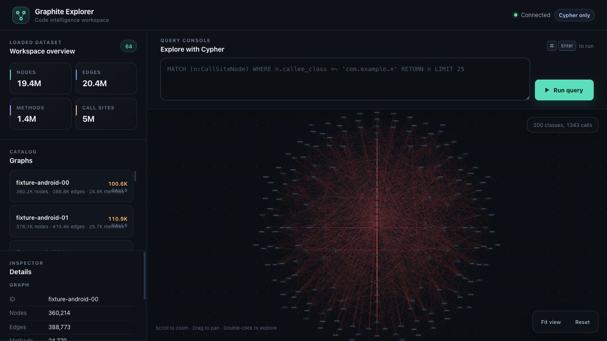

# Graphite

[](LICENSE)

[English](README.md) · 简体中文

**为 LLM 提供结构化的代码库上下文。** Graphite 将 JVM 字节码和 TypeScript 源码转换为可查询的程序图，让 AI 智能体无需逐一阅读文件就能理解你的代码库。

[生产环境规模](#生产环境规模) · [运行演示](docs/quickstart-demo.md) · [快速开始](#快速开始) · [接入 AI 智能体](#mcp-集成) · [Kotlin API](#kotlin-api)



**64 张图 · 1940 万节点 · 2040 万条边。** 在已加载的 Android、Tika、Hive 和 Kotlin 编译器字节码图集中探索类调用关系。[复现这个视图](docs/public-scale-demo.md)。

## 问题

LLM 处理代码时面临一个根本约束：**代码库的大小可能超出单次提示词能够容纳的范围。** 找到一个方法只是起点。要回答“哪些常量会传入这个 API？”或“谁调用了这个方法？”，智能体必须串联分散在调用方、字段、类型和依赖项中的信息。

源文件包含所需证据，但检索文件后，智能体仍然需要自行重建这些关系。Graphite 让这些关系可以直接查询，使智能体能够针对当前问题获取相关上下文。

## 解决方案

Graphite 构建**程序图**：节点表示程序元素，边表示调用、数据流等关系。智能体可以发现图的 schema，通过 MCP 使用 Cypher 查询图，并获取结构化结果。同一张图也可以通过 CLI 和 Web Explorer 访问。

例如，要分析一个功能开关，可以查询流入开关 API 的常量，以及包含这些调用点的方法。查询结果为智能体提供具体证据，供其进一步分析。下方教程展示了这两种查询及其实际输出。

## 为什么不直接用 Tree-sitter？

**程序语义是 Graphite 的基础。** 图模型直接表示值、参数、返回值、字段、调用和类型，让代码关系成为智能体可以查询的上下文。

JVM 前端从**编译后的字节码**出发：方法描述符、字段引用和指令已经携带编译器确定的信息。Graphite 在此基础上构建程序模型，**无需源码**即可分析应用产物和第三方依赖。JVM 分析 API 内置跨方法参数的反向切片，可以追踪一个值来自哪些调用方实参。

[Tree-sitter](https://tree-sitter.github.io/tree-sitter/) 提供语法树。在其上构建同等级别的程序分析，需要另外实现符号与类型解析、控制流与数据流模型、实参与形参映射，以及跨方法分析。这些都是超出解析器职责的分析系统。Graphite 将程序图模型、持久化存储和 Cypher／MCP 访问整合在同一套系统中。

这套基础也已用于生产规模：**单进程服务 40+ 张图、100M+ 节点**；仓库还提供包含 1,940 万节点的[公开 64 图演示及复现步骤](docs/public-scale-demo.md)。

| 问题 | 语法之外所需的信息 | Graphite 提供的可查询上下文 |
|----------|---------------------------|-----------------------------|
| 哪些常量会传入这个参数？ | 经过赋值、字段和调用的数据流 | 常量节点与数据流关系 |
| 这个方法在哪里被调用？ | 方法标识和调用目标 | 包含调用方与被调用方描述符的调用点 |
| 哪些类型实现了这个接口？ | 已解析的类型关系 | 已索引的类与接口层级 |
| 这个 lambda 或方法引用实际执行什么？ | 编译器生成的链接信息 | 从方法句柄和编译器生成的 lambda 类中解析出的实现 |
| 这个配置键在哪里被读取？ | 代码与打包资源之间的联系 | 资源值与受支持的查找关系 |

图反映的是对所提供产物的静态分析。覆盖范围取决于包含的类、依赖项和受支持的分析模式；反射和动态加载可能导致部分关系无法解析。

**与 CodeGraph 1.6.0 的实测对照：** Graphite 识别出了对方图中遗漏的 Kotlin 调用 Java 属性方法的关系，通过 MCP 提供可编程聚合查询；在 Commons Lang 上，对同样返回 9 个调用者的查询进行五轮测量，Graphite 的中位延迟为对方的 **约 1/2.38–1/2.65**。详见[对照结果、原始数据与复现步骤](docs/codegraph-comparison.md)，其中列出了版本、查询范围和大型项目中的发现。

## 生产环境规模

**单个进程服务 40+ 张图，共计 100M+ 节点。**

以下数据测量自生产环境部署的 `graphite serve`（Rust 后端，图通过内存映射加载）：

| | |
|---|---|
| 单个进程服务的图数量 | 40+ |
| 节点 | 100M+ |
| 边 | 100M+ |
| 方法 | 10M+ |
| 调用点 | 20M+ |
| Cypher 延迟，P50 | ~500 ms |
| Cypher 延迟，P95 | ~15 s |

延迟统计来自生产环境的混合查询流，其中大部分为跨图查询。针对类、方法或常量的精确查询可通过字符串索引在毫秒级返回；P95 对应的是遍历每个节点所有属性的宽泛查询。通过 `--metrics`，你也可以在自己的部署中查看相同指标，包括 `http_server_requests_seconds` 和 Cypher 系列指标。

## 本地试用

试着问：**“哪个常量传入了 `enableFeature`，又是谁调用了它？”** [可运行的 Java 示例](docs/quickstart-demo.md) 会编译一个小型 JAR，构建程序图，并通过两次查询分别返回 `42` 和 `demo.Checkout.startCheckout()`。无需应用服务器或 AI 订阅。

安装 Graphite 和 JDK 17 或更新版本后：

```bash
git clone https://github.com/johnsonlee/graphite.git
cd graphite
bash examples/quickstart/run.sh
```

完整查询、预期 JSON 输出，以及在 Web Explorer 中打开已保存图的命令，均可在教程中找到。

## 图中包含哪些信息

| 关系 | 示例 | 可以帮助回答的问题 |
|-------------|---------|-------------------------|
| **数据流** | `x = 42; foo(x)` → 常量 42 流入 `foo` | 哪些常量可能传入这个参数？ |
| **调用图** | `UserService.save()` 调用 `Repository.insert()` | 这个方法在哪里被调用？ |
| **类型层级** | `AdminUser extends User implements Auditable` | 哪些已索引的类型实现了这个接口？ |
| **注解** | `listUsers()` 上的 `@GetMapping("/api/users")` | 这个应用声明了哪些端点？ |
| **Lambda/方法引用** | `items.stream().map(User::getName)` | 这个引用指向哪个方法？ |
| **资源** | fat JAR 中的 `config/application.yml` | 打包的配置键在哪里被读取？ |

Graphite 使用**面向读取的 Cypher 子集**进行查询。`graphite` 二进制程序在执行 `query`、`serve` 和 `mcp` 时使用 `backend/cypher` 中的 Rust 引擎；Kotlin API 的 `graph.query(...)` 则使用 `frontend/jvm/cypher` 中基于 ANTLR 的引擎。差分测试框架（`backend/bench`）会对照检查这两套实现。

## 前端支持

当前发布的前端支持读取 JVM 和 Android 产物。构建图需要 Java；分析 APK 还需要 Android 平台 jar。分析这些输入时，无需检出其源代码。

**TypeScript 源码前端**支持通过 `graphite build --lang ts` 分析 `tsconfig.json`、源码目录或 TS/JS 文件。在 Graphite 源码仓库中构建 `frontend/web`，并通过 `GRAPHITE_FRONTEND_TS` 指定其 `dist/cli.js` 入口。分析需要 Node.js 20 或更新版本；保存的图可直接使用相同的 Rust 查询、服务和 `.graphite` 容器命令：

```bash
npm ci --prefix frontend/web
npm test --prefix frontend/web
cargo build --release --locked -p graphite-cli
export GRAPHITE_FRONTEND_TS="$PWD/frontend/web/dist/cli.js"

./target/release/graphite build --lang ts /path/to/project/tsconfig.json -o /tmp/project.graphite
./target/release/graphite verify /tmp/project.graphite
./target/release/graphite query /tmp/project.graphite \
  "MATCH (cs:CallSite) RETURN cs.caller_class, cs.caller_name, cs.callee_name, cs.line LIMIT 20" \
  --format json
```

分析不会运行目标项目的脚本或安装其依赖。静态分析的覆盖边界、语义诊断行为以及固定版本 mitt/Zod 的端到端验证步骤，详见 [TypeScript 前端文档](docs/typescript-frontend.md)。此源码前端需单独构建，JVM 的 Homebrew 安装不会自动安装它。

**开发中：** [Swift / iOS 支持（#154）](https://github.com/johnsonlee/graphite/pull/154) 正在新增面向 Swift 包和 Xcode 项目的 Apple 前端，通过 Graph IR 接入共享程序图。这项工作尚未合并。语言前端为 Graphite 的结构化上下文与查询工具扩展输入途径。

## 快速开始

```bash
# Install via Homebrew
brew tap johnsonlee/tap
brew install johnsonlee/tap/graphite
graphite --version

# Build a graph from your JAR
graphite build app.jar -o /data/app-graph --include com.example

# Build a graph from an Android APK
graphite build app.apk \
  -o /data/apk-graph \
  --include com.example

# Query with Cypher
graphite query /data/app-graph \
  "MATCH (c:IntConstant)-[:DATAFLOW*]->(cs:CallSiteNode)
   WHERE cs.callee_class =~ 'com.example.*'
   RETURN c.value, cs.callee_name"

# JSON output (for LLM consumption)
graphite query --format json /data/app-graph \
  "MATCH (n:CallSiteNode) RETURN n.callee_name LIMIT 10"

# Launch the web UI
graphite serve --id app /data/app-graph --port 8080

# Serve every .graphite file in a directory, each under its file name
# (/data/graphs/orders.graphite is served as `orders`).
graphite serve --data /data/graphs --port 8080

# Serve multiple graphs by id. Relative graph paths resolve under --data, and any
# .graphite file directly under --data is served too.
graphite serve --data /data/graphs \
  --graph orders:orders-graph \
  --graph billing:/data/billing-graph \
  --topology /rules/company-topology.cypher \
  --max-concurrent-cypher 4 \
  --cypher-max-timeout-ms 60000 \
  --port 8080

# Hot-load or replace a graph without restarting the server
curl -X PUT http://localhost:8080/api/graphs/orders \
  -H 'Content-Type: application/json' \
  -d '{"path":"/data/graphs/orders-graph-v2"}'
```

### Homebrew formula 安装的内容

`graphite` 是原生二进制程序（Rust），自身提供 `query` 和 `serve`，并通过 JVM 前端 `graphite.jar` 执行 `build`。Homebrew formula 会将该 jar 安装在二进制程序旁边，同时安装 `openjdk@17`。原来面向 jar 版 formula 编写的所有命令行均可原样使用，包括 `--profile` 以及 `JAVA_OPTS`/`JAVA_TOOL_OPTIONS` 堆内存设置。

未指定 JVM 参数时，`graphite build` 会检查所选 JVM 是否支持以下 G1 配置，并将其用于 jar 形式的 JVM 前端，包括 JAR 和 APK 输入。最大堆仍为 8 GiB：

```text
-Xmx8g -XX:+UseG1GC -XX:+UnlockExperimentalVMOptions -XX:G1MaxNewSizePercent=30 -XX:MinHeapFreeRatio=20 -XX:GCTimeRatio=4
```

每条 build 命令只检查一次，包括需要两次构建的 fold 命令。无法确认支持时，保留原来的 `-Xmx8g` 配置。可执行形式的前端启动器自行管理参数。

显式设置非空的 `JAVA_TOOL_OPTIONS`、`JAVA_OPTS`、`JDK_JAVA_OPTIONS` 或 `_JAVA_OPTIONS` 会跳过检查和自动 GC 调整。CLI 仍优先使用 `JAVA_TOOL_OPTIONS`，其次是 `JAVA_OPTS`；`JDK_JAVA_OPTIONS` 和 `_JAVA_OPTIONS` 由 JVM 自行处理。例如，未设置 `JAVA_TOOL_OPTIONS` 时，可使用 `JAVA_OPTS='-Xmx2g'` 指定较小的堆。这些参数不用于调节原生 `query` 或 `serve`，最大堆也不等于进程峰值 RSS。

这组 G1 配置的匹配性能对照使用 macOS ARM64 上的 HotSpot 17，输入为 Kotlin compiler 2.0.21 和 Tika 2.9.2 JAR。结果、测量边界和限制见[实验记录](docs/webgraph-optimization-attempts.md)；通过能力检查不代表所有 JVM 或工作负载都有相同的性能。

```bash
graphite frontend list           # which frontend `build` will run, and where it came from
graphite frontend describe jvm   # JSON: version, accepted inputs
graphite frontend install jvm    # fetch the jar for this CLI's version into ~/.graphite/frontends
```

不使用 Homebrew 时，`graphite build` 会依次通过以下位置查找前端：`GRAPHITE_FRONTEND_JVM`（jar 或启动器）、二进制程序旁边或同级 `libexec/` 目录中的 `graphite.jar`、`PATH` 中的 `graphite-frontend-jvm`，最后是 `~/.graphite/frontends/jvm/`。查找 `java` 的顺序为 `GRAPHITE_JAVA`、`JAVA_HOME`，然后是 `PATH`。发布包也单独提供 `graphite.jar`；`java -jar graphite.jar build|query|serve` 仍然可用。

### 升级旧版安装

旧版安装器可能将 `~/.graphite/bin/graphite` 放在 `PATH` 中比 Homebrew 更靠前的位置。在这种情况下，安装或升级 formula 不会改变 `graphite` 命令实际调用的可执行文件。请移走旧版安装，刷新命令查找缓存，并重新构建已保存的图，使其包含当前的资源存储：

```bash
type -a graphite
mv ~/.graphite ~/.graphite.legacy
hash -r
brew upgrade johnsonlee/tap/graphite
graphite --version
graphite build app.jar -o /data/app-graph --include com.example
```

对于 APK 输入，Graphite 使用 Android 平台 jar 解析 APK 的目标 API 级别。可以通过 `--android-sdk` 指定 Android SDK 根目录。如果省略此选项，Graphite 将按以下顺序搜索：

1. `ANDROID_HOME`，然后是 `ANDROID_SDK_ROOT`。
2. 当前操作系统的默认 SDK 根目录：
   - macOS：`~/Library/Android/sdk`、
     `/opt/homebrew/share/android-commandlinetools`、
     `/usr/local/share/android-commandlinetools`
   - Linux：`~/Android/Sdk`、`~/android-sdk`、`/opt/android-sdk`、
     `/usr/local/android-sdk`、`/usr/lib/android-sdk`
   - Windows：`%USERPROFILE%\AppData\Local\Android\Sdk`
3. 从 `PATH` 中的 `adb`、`emulator` 或 `sdkmanager` 推断出的 SDK 根目录。

### 在构图时折叠开关条件

即使功能开关或实验尚未开启，将新代码放在开关后面的 PR 也会改变图。`--fold` 指定需要折叠的调用点：在构图时、任何节点创建之前，每个匹配的调用都会替换为常量。依赖该值的分支随之折叠，被排除的分支则被移除。如果开关折叠为 `false`，受它控制的代码块就不会留下任何图内容，无论代码写成 `if (gate) { ... }`、`if (!gate) return;` 还是 `x = a && gate()`。用同一份规则文件构建 base 和 head，比较两张图时就不会看到这些被开关屏蔽的代码。

```bash
graphite build app.jar -o /data/app-graph --include com.example --fold folds.yml
```

#### 折叠规则文件

规则沿用图自身的术语，写法类似 Cypher `MATCH` 指定节点：需要匹配的 `CallSite` 属性、必须流入各参数的常量，以及调用将被替换成的常量。当属性和参数常量不足以描述要折叠的调用时，可以改用 Cypher 查询（见下文的 `select`）。JSON 和 YAML 使用相同的键。

```yaml
# folds.yml
version: 1
folds:
  # Flags.isEnabled("new_checkout") 在所有位置都为 false
  - match:
      CallSite: { callee_class: com.example.Flags, callee_name: isEnabled }
    args:
      0: new_checkout
    value: false

  # Flags.isEnabled(Flag.DARK_MODE) 为 true，但仅限 checkout 包中的调用
  - match:
      CallSite: { callee_class: com.example.Flags, callee_name: isEnabled, caller_class: "com.example.checkout.*" }
    args:
      0: { EnumConstant: { enum_type: com.example.Flag, name: DARK_MODE } }
    value: true

  # Experiments.variant(<任意字符串>, 7L) 为 0；标签限定常量类型
  - match:
      CallSite: { callee_signature: com.example.Experiments.variant(java.lang.String,long) }
    args:
      0: { StringConstant: {} }
      1: { LongConstant: { value: 7 } }
    value: { IntConstant: { value: 0 } }

  # Flags.limit() 的所有调用，不限制参数
  - match:
      CallSite: { callee_class: com.example.Flags, callee_name: limit }
    value: 3
```

| 键 | 含义 |
|---|---|
| `version` | `1` |
| `folds` | 按顺序列出的规则。每个调用只应用第一条匹配的规则 |
| `match` | 仅允许 `CallSite` 标签，后跟调用点必须具有的属性。列出的所有属性都必须匹配；值中的 `*` 匹配任意长度的字符序列 |
| `args` | 可选。将参数索引（第一个参数为 `0`）映射到必须流入该参数的常量节点。调用没有对应索引的参数时，不会匹配 |
| `select` | 替代 `match`：在未应用折叠规则的图上执行 Cypher 查询，返回要折叠的 `CallSite` 节点。无论外层方法由谁调用，每个选中的调用都会折叠。`args`（与 `match` 中相同）和 `receiver_args` 是附加条件；后者指定产生接收者的调用必须传入哪些常量，例如 `Box a = boxed(1234); if (a.isOn())` 对应 `receiver_args: {0: 1234}`。无法证明这些条件成立的调用会被记录并保持原样 |
| `value` | 调用将被替换成的常量 |
| `frontend` | 可选。指定其他前端（`jvm`、`swift`、`js`）的规则会被当前前端跳过 |

`CallSite` 属性与查询中使用的属性一致：`callee_class`、`callee_name`、`callee_signature`（`pkg.Cls.name(p1,p2)`，用于指定某个重载）、`callee_descriptor`（包含返回类型的 JVM 描述符，如 `(Ljava/lang/String;)Z`）、`caller_class`、`caller_name`、`caller_signature`、`caller_descriptor` 和 `ordinal`。至少需要一个 `callee_*` 属性。

与图中的定义相同，`callee_class` 表示声明该方法的类：如果 `Sub.isEnabled()` 调用的方法声明在 `Base` 中，它对应的是 `callee_class: Base`。`ordinal` 按调用方法字节码中的语句顺序，从 `0` 开始统计对同一被调用方法的每次调用；这也包括图中以数据流而非调用点呈现的装箱和拆箱调用。因此，`{caller_signature, caller_descriptor, callee_signature, callee_descriptor, ordinal}` 可以标识唯一的调用点。`select` 查询从未应用规则的图中读取这个键，再将规则应用于同一份输入时，折叠的就是该调用。

常量节点可以写成标量，也可以写成 `{Label: {properties}}`：

| 写法 | 匹配对象 |
|---|---|
| `new_checkout`、`7`、`true`、`0.5` | 具有该值的任意标签常量。数值按数值比较，不受位宽影响，因此 `7` 可以匹配 `7L`；整数精确比较（保留 `long` 的全部位），浮点数遵循 IEEE 754（`-0.0` 匹配 `0.0`，`NaN` 不匹配任何值） |
| `null` | `NullConstant` |
| `{StringConstant: {value: "checkout_*"}}` | 字符串常量；其值也支持 glob 通配符 |
| `{BooleanConstant: {value: true}}`、`{IntConstant: {value: 7}}`、`{LongConstant: {value: 7}}`、`{FloatConstant: {value: 1.5}}`、`{DoubleConstant: {value: 0.5}}` | 类型和值都完全一致的常量 |
| `{StringConstant: {}}`、`{LongConstant: {}}` 等 | 该类型的任意常量 |
| `{EnumConstant: {enum_type: com.example.Flag, name: DARK_MODE}}` | 枚举常量，即枚举类声明为枚举项的字段（带 `ACC_ENUM`；枚举类中的其他静态字段属于 `FieldNode`）。用作 `value` 时，调用会替换成该常量，方法必须返回这个枚举类型。与枚举常量的 `==`/`!=` 比较会折叠；操作数已知且枚举接收者非空时，`equals(Object)` 也会折叠 |
| `{FieldNode: {class: com.example.Flags, name: MARKER}}` | 其他静态字段读取 |

规则替换查找调用后，操作数已知的 String 和基本类型包装类 `equals(Object)` 比较也会折叠。`Objects.equals(Object, Object)` 和 Kotlin 对象比较的 `Intrinsics.areEqual` 支持已知值与 null。运行时作用域条件保持不变；未知值和自定义 `equals` 实现仍保留为调用。

只有常量参数才能匹配：字面量、编译器内联的 `static final`，或枚举常量。经参数、字段或计算传入调用的键不属于这类常量，此时会记录该调用，但不折叠。标量形式的 `value` 按返回类型表示（`false` 用于 `boolean`，`3` 可用于 `int`、`long`、`float` 或 `double`，`null` 可用于任意引用类型）；带标签的常量则必须与返回类型完全匹配。返回类型无法表示该值的调用会被记录并保持原样。

YAML 1.1 会将未加引号的 `on`、`off`、`yes` 或 `no` 解析为布尔值：方法名或键使用这些名称时，需要加引号。

#### 用 Cypher 选择调用点

`match` 只能描述一个调用：它的属性，以及流入其参数的常量。如果开关的键在别处构造，例如 `getAbTestOption(fn)` 中的 `fn` 经辅助方法返回 `ABTest.of(ImmutableList.of(ABKey.of(1234)))`，就不能仅靠一个调用描述它。这是图中的一条路径，可以直接用 Cypher 表达。`select` 规则就是这样的查询：

```yaml
version: 1
folds:
  # 常量 1234 经任意辅助方法流入的所有 getAbTestOption(...) 调用
  - select: >
      MATCH (k:IntConstant {value: 1234})-[:DATAFLOW*1..8]->(cs:CallSite {callee_name: 'getAbTestOption'})
      RETURN cs
    value: { EnumConstant: { enum_type: com.example.ABTestOption, name: CONTROL } }
```

查询中的字符串遵循 Cypher 语法，需要加引号，与 `match` 中可以不加引号的标量不同。`graphite build` 负责解析这类规则：先在输出目录旁的临时目录中构建未应用规则的图，用 Rust 引擎执行每条 `select`，读取各 `CallSite` 行的稳定键（`caller_signature`、`callee_signature`、`ordinal`），再折叠这些调用点并重新构图。查询必须只返回一列 `CallSite` 节点（`RETURN cs`）；返回属性、多列或其他节点的查询会被拒绝，并显示出错的行及其内容。查询未选中任何调用的规则，与未匹配到任何调用的 `match` 一样会被记录；启用 `--fold-strict` 时构建会失败。

报告在 `select` 下保留查询，在 `selected` 下列出选中的键。对于已填好 `selected` 的文件（报告自身的 `folds`，或根据 `RETURN cs.caller_signature, cs.callee_signature, cs.ordinal` 手工填写的键），CLI 和 `graphite.jar build` 都只需一遍构建。单独运行 `graphite.jar build` 时，没有可执行查询的图，因此会拒绝尚未解析的 `select`。

键之所以稳定，是因为 `ordinal` 按语句顺序标识调用方对同一被调用方法的第几次调用；构图与折叠阶段使用同一个函数，在相同方法体上计数。只有在同一方法中、该位置之前增删了对同一被调用方法的调用，序号才会改变。折叠移除调用后会留下序号空缺，保留下来的调用仍使用字节码中的原序号，因此从已折叠图中读取的键仍指向同一个调用。派生调用（通过函数值到达的 lambda 方法体）从 `-1` 开始递减编号，不能作为开关：查询返回这类调用时会被拒绝，应改为选择对函数值的调用。选择操作在未应用规则的图上进行，随后应用于相同字节码，因此会命中相同调用。

#### 构建过程的诊断信息

读取任何字节码之前，程序就会校验规则文件。每个错误都会指出文件、规则、键，以及应如何修正：

```
folds.yml: folds[0]: unknown CallSite property 'callee_clas' (did you mean 'callee_class'?); use callee_class, callee_name, callee_signature, caller_class, caller_name, caller_signature or ordinal
folds.yml: folds[1]: 'args.0': unknown constant label 'String' (did you mean 'StringConstant'?); use BooleanConstant, Constant, DoubleConstant, EnumConstant, FieldNode, FloatConstant, IntConstant, LongConstant, NullConstant or StringConstant
folds.yml: folds[2]: 'match.CallSite.callee_name' must be a string, got boolean true (YAML reads a bare on, off, yes or no as a boolean: quote it)
```

构建过程为每条规则输出一行信息。没有折叠任何调用的规则会产生警告，并列出最接近的调用，便于立即发现类名、键或调用方范围不正确的问题；同时还会给出一条 Cypher 查询，用于在未应用该规则的图上预览匹配结果：

```
fold CallSite {callee_class: com.example.Flags, callee_name: isEnabled} [0: "new_checkout"] = false: 0 call(s) in 0 method(s), 0 statement(s) removed, 1 unsupported
  warning: this rule folded nothing, no call matched; the nearest are:
    com.example.Flags.isEnabled(java.lang.String) is called with argument 0 = StringConstant {value: "new-checkout"} (12 call(s))
    com.example.Flags.isEnabled(java.lang.String) is called with argument 0 = not a constant (1 call(s))
    preview on a built graph: MATCH (cs:CallSite {callee_class: "com.example.Flags", callee_name: "isEnabled"}), (a0:Constant {value: "new_checkout"})-[:DATAFLOW*1..2]->(cs) RETURN cs.caller_signature AS caller, count(cs) AS calls
Warning: no fold rule folded any call; the graph is the same as a build without --fold
```

`--fold-strict` 会使未匹配到任何调用的规则导致构建失败。输出目录中的 `graph.folds.json` 按原文件的结构保留所有规则，并为每条规则补充预览查询、已折叠的调用、调用方方法及其折叠前后的语句数、匹配到但无法折叠的调用及其原因，以及接近但未匹配的调用。它本身也可以作为折叠规则文件使用：`--fold graph.folds.json` 读取其中的规则，忽略附加信息。没有被规则触及的方法仍按前端默认流程处理，因此折叠只会改变调用了被折叠方法的那些方法。各处理阶段的详细行为见 `docs/constant-folding.md`。

## Kotlin API

### 构建与查询

```kotlin
// Build graph from bytecode
val graph = JavaProjectLoader(LoaderConfig(
    includePackages = listOf("com.example")
)).load(Path.of("/path/to/app.jar"))

// Cypher query
val result = graph.query("""
    MATCH (c:IntConstant)-[:DATAFLOW*]->(cs:CallSiteNode)
    WHERE cs.callee_class =~ 'com.example.*'
    RETURN c.value, cs.callee_name
""")
result.rows.forEach { row ->
    println("${row["c.value"]} -> ${row["cs.callee_name"]}")
}

// Bind values without interpolating them into the query text
val selected = graph.query(
    "MATCH (c:IntConstant) WHERE c.value = \$value RETURN c",
    mapOf("value" to 42)
)

// Programmatic query DSL
val results = Graphite.from(graph).query {
    findArgumentConstants {
        method {
            declaringClass = "com.example.ab.AbClient"
            name = "getOption"
        }
        argumentIndex = 0
    }
}

// Annotations, dataflow analysis
val annotations = graph.memberAnnotations("com.example.User", "name")
val slice = DataFlowAnalysis(graph).backwardSlice(nodeId)
slice.constants()  // all constant values that reach this node
```

### 持久化与加载

```kotlin
// Save to disk (WebGraph compressed format)
GraphStore.save(graph, Path.of("/data/app-graph"))

// Load — auto-adaptive based on graph size:
//   < 1M nodes → eager (all in heap, fastest queries)
//   >= 1M nodes → mmap (nodes off heap, 75% less memory)
val graph = GraphStore.load(Path.of("/data/app-graph"))

// Or force a specific strategy
val graph = GraphStore.load(dir, GraphStore.LoadMode.EAGER)   // always in-heap
val graph = GraphStore.load(dir, GraphStore.LoadMode.MAPPED)  // always mmap
```

### 访问资源

```kotlin
graph.resources.list("**/*.xml").forEach { entry ->
    println(entry.path)  // e.g., "config/application.yml"
}
```

### 使用 Cypher 查询资源

资源也会被索引到图中，因此可以通过 Cypher 查询，并与调用点交叉关联：

```cypher
// Structured resource values
MATCH (r:ResourceValue {key: "feature.mode"})
RETURN r.path, r.value

// Nested JSON / XML values
MATCH (r:ResourceValue)
WHERE r.key IN ["feature.enabled", "service.endpoint", "service.@enabled"]
RETURN r.path, r.key, r.value

// Which call sites read a specific key
MATCH (r:ResourceValue {key: "feature.mode"})-[:RESOURCE_LOOKUP]->(cs:CallSiteNode)
RETURN cs.caller_signature, cs.callee_signature

// Resource files opened by code
MATCH (f:ResourceFile)-[e:RESOURCE_OPEN|RESOURCE_LOAD|RESOURCE_BUNDLE_CANDIDATE]->(cs:CallSiteNode)
RETURN f.path, e.kind, cs.caller_signature, cs.callee_signature
```

资源关系以专用边类型表示：

| 类型 | 含义 |
|------|------|
| `RESOURCE_CONTAINS` | `ResourceFile -> ResourceValue` |
| `RESOURCE_OPEN` | 代码直接打开的资源文件 |
| `RESOURCE_LOAD` | 由解析器或资源包加载的资源内容 |
| `RESOURCE_BUNDLE_CANDIDATE` | `ResourceBundle.getBundle(...)` 的候选资源解析 |
| `RESOURCE_LOOKUP` | 具体的键值查找（`getProperty`、`getString`、`getObject`） |
| `RESOURCE_KEYS` | 键枚举（`getKeys`） |

目前，资源路径索引覆盖：

- `.properties`
- `.yml` / `.yaml`
- Java properties XML（`Properties.loadFromXML`）
- `.json`
- 通用 `.xml`
- 通过路径级类索引支持的 `ListResourceBundle` / 基于 provider 的类资源包

目前，通用 JDK 资源关联覆盖：

- `ClassLoader.getResource*`
- `Properties.load(...)`
- `Properties.loadFromXML(...)`
- `PropertyResourceBundle(...)`
- `ResourceBundle.getString/getObject/getKeys`
- 支持区域设置候选解析的 `ResourceBundle.getBundle(...)`
- 常见的 `ResourceBundle.Control` 用法，包括 `FORMAT_*`、禁用回退的控制器，以及简单的自定义 `getFormats/getCandidateLocales` 重写

### 探索资源 API

`graphite serve` 为 AI 智能体和工具提供支持资源查询的 HTTP API：

| 端点 | 说明 |
|------|------|
| `/api/graphs` | 列出已加载的 webgraph，包含缓存的各图统计信息和汇总数据 |
| `/api/graphs/{graphId}` | 按 ID 获取、加载、替换或卸载 webgraph |
| `/api/graphs/{graphId}/...` | 查询指定的一个 webgraph，直接返回单图响应结构 |
| `/api/topology` | 获取启动时根据 `--topology` 规则推导出的图间调用拓扑 |
| `/api/cypher` | 在所有已加载图的并集上执行一次 Cypher 查询 |
| `/api/cypher/graphs` | 在指定图集合上执行一次查询，或显式地对各图分别执行查询 |
| `/api/resources` | 列出所有图中已索引的资源，按 `graphId` 分组 |
| `/api/resources/{path}` | 读取所有匹配的资源，按 `graphId` 分组，避免路径冲突 |
| `/api/endpoints` | 提取所有图中的框架 HTTP 端点，按 `graphId` 分组 |
| `/metrics` | 服务器以 `--metrics` 启动时提供的 Prometheus 性能指标 |
| `/openapi.json` | 探索服务器的机器可读 OpenAPI 文档 |
| `/swagger.json` | 同一 API 文档的 Swagger 兼容别名 |

图内局部节点 ID 仅适用于图级路由，例如 `/api/graphs/{graphId}/node/{id}` 和 `/api/graphs/{graphId}/subgraph?center={id}`。没有对应的根路由，因为相同的局部 ID 在不同图中可能指向完全无关的节点。

没有默认图，也不会自动选择图。根级图 API 始终表示所有已加载的图；`/api/graphs/{graphId}/...` 始终只表示一个指定的图。所有根级非 Cypher 结果都按 `graphId` 分组；每一行跨图 Cypher 结果都包含 `$metadata.graphIds`，返回的图元素则包含限定身份标识，例如 `elementId = "orders:42"`。

旧版 `/api/nodes`、`/api/call-sites` 和 `/api/methods` 搜索路由，以及 MCP `methods` 工具已在 2.x 期间移除。智能体应使用 Cypher 发现节点、调用点和方法。`/openapi.json` 描述了全部受支持的接口。

已声明的方法元数据（包括已索引但没有图节点的方法）可通过虚拟 `Method` 数据源获取：

```cypher
MATCH (method:Method)
RETURN method.signature, method.class, method.name,
       method.parameter_types, method.return_type
LIMIT 50
```

`Method` 值是虚拟元数据记录，并非存储在图中的节点。可以通过 `elementId(method)` 获取其稳定的字符串标识；由于不存在数值型图节点 ID，`id(method)` 返回 `null`。

JVM 声明中的泛型可通过 `Method.generic_return_type`、`Method.generic_parameter_types`，以及字段、参数、返回节点的 `generic_type` 查询。结构化类型信息保留嵌套泛型、类型变量作用域和通配符；类型保存在独立的去重表中。查询属性、存储格式与旧图兼容行为见 [JVM 声明类型](docs/declared-types.md)。

每个 Cypher 响应都会说明返回的行是否为全部结果。除了 `rowCount`（响应中的行数），还包含 `total`，其结构与 Elasticsearch 的 `hits.total` 一致：

```json
{ "columns": ["n.callee_name"], "rows": [ … ], "rowCount": 1000,
  "total": { "value": 1001, "relation": "gte" } }
```

当 `value` 是查询的精确总行数时，`relation` 为 `eq`；当至少存在 `value` 行，但响应被 `LIMIT`、`limit` 参数（默认 1000，最大 5000）或分图执行时的 `perGraphLimit` 截断时，`relation` 为 `gte`。引擎通过在限制之外多匹配一行来判断，无须统计全部结果；因此，`LIMIT 0` 可以回答“是否存在任何结果行”。在 `/api/cypher/graphs` 中，每个图的结果也都有自己的 `total`。

全局发现查询应使用 `/api/cypher`。先枚举 `/api/graphs`，再逐一调用 `/api/graphs/{graphId}/cypher`，相当于在客户端分图执行，会重复产生 HTTP 和 Cypher 解析开销。

Cypher 端点默认最多允许四个查询同时执行，并将请求超时上限设为 60 秒。可通过 `--max-concurrent-cypher` 和 `--cypher-max-timeout-ms` 配置这些限制。客户端可以在查询字符串或 JSON 请求体中指定更短的正数 `timeoutMs`；实际超时时间取客户端值与服务器上限中的较小值。超时会自动取消并中断相应查询，返回 HTTP 504，`code` 为 `cypher_query_timeout`。因并发限制而拒绝的请求返回 HTTP 429，`code` 为 `cypher_concurrency_limit`。

`--cypher-work-budget` 已弃用并被忽略。为保持命令行兼容性，该参数仍可传入，但不再限制服务器请求。核心库的调用方仍可直接使用 `CypherExecutionBudget`。

`graphite` 二进制程序中的 `=~` 运算符采用 Rust `regex` crate 的语法：线性时间匹配，不支持反向引用、环视或占有量词。使用这些结构的模式会导致查询失败，报错 `Unsupported regex construct in pattern`，而非返回空匹配结果。Kotlin 引擎（`graph.query(...)` 和旧版 `graphite.jar serve`）完整保留 Java `Pattern` 语法。

因超时以外的原因停止的查询返回 HTTP 503，`code` 为 `cypher_query_cancelled`；绝不会被报告为空的 HTTP 200 响应。旧版 `graphite.jar serve` 还会在观察到连接关闭、TCP 重置或套接字错误时取消查询，并在 Cypher 执行期间暂停 Jetty 的空闲计时；详见 [docs/cypher-client-cancellation-attempts.md](docs/cypher-client-cancellation-attempts.md)。

使用 `--metrics` 启动服务器，即可通过 `/metrics` 获取 Prometheus 格式的指标。指标采集需要显式启用，因此默认请求路径没有监测开销。`graphite` 二进制程序导出原生进程自身可获取的信息：`process_*`（CPU 秒数、常驻与虚拟内存、线程数、已打开和最大文件描述符数、启动时间、运行时长）、`system_load_average_1m` 和 `system_cpu_count`；按 HTTP 方法、路由模板、状态码和处理结果划分的延迟直方图 `http_server_requests_seconds`，以及 `http_server_requests_active`；还有所服务图的指标 `graphite_graphs_loaded`、`graphite_graph_nodes`、`graphite_graph_edges` 和 `graphite_graph_mapped_bytes`。

两个 `_info` gauge 为多实例部署提供身份信息：`graphite_build_info{version,commit}`（发布构建设置了提交信息时使用该提交，否则为 `unknown`）和 `graphite_graph_info{graph,fingerprint}`（每个正在提供服务的图各有一个）。其中，指纹是图清单文件的 SHA-256；图目录与由它打包生成的 `.graphite` 文件具有相同指纹，因此发布时可以检查各实例是否使用相同的构建和图数据。与惯例一致，采集来源实例由采集器的 `instance` 标签标识；任何时间序列都不包含主机名。Cypher 指标涵盖活跃查询数、并发上限、拒绝次数，以及按固定结果类型划分的执行时长。

通过 `POST /mcp` 提供的 MCP 也在监测范围内：`graphite_mcp_requests_total` 按方法统计 JSON-RPC 请求数（`initialize`、`ping`、`tools/list`、`tools/call`，其余归为 `other`）；`graphite_mcp_tool_duration_seconds` 是按 `tool`（`tools/list` 返回的名称）和 `outcome`（`ok`，或工具返回 `isError` 时的 `error`）划分的延迟直方图，分桶与 Cypher 直方图相同。一次工具调用在 `http_server_requests_seconds` 中计为一次 `/mcp` 请求；它在进程内部发起的 API 调用不会重复计数。通过 stdio 运行的 `graphite mcp` 不提供 `/metrics`，也不记录任何指标。（旧版 `graphite.jar serve` 导出的是 JVM 堆、GC 和线程指标，以及 Jetty 的请求计时指标。）

图 ID、查询文本、关键词、类和方法绝不会用作指标标签。HTTP URI 标签采用路由模板，最多允许 64 个不同值；会产生第 65 个模板的请求不会被记录。

要发现标签，可使用下面基于元数据的直方图查询。Graphite 直接根据节点类型计数返回结果，无须访问图节点：

```cypher
MATCH (n)
UNWIND labels(n) AS label
RETURN label, count(*) AS count
ORDER BY count DESC
LIMIT 50
```

多图启动时，`--topology` 接受一个 Cypher 文件（或包含 `.cypher` 文件的目录）。配置的 `--graph` 条目构成图目录：Graphite 将这些图加载一次，在已加载的图实例上执行拓扑查询，再将返回的行汇总为进程内的拓扑图。每当图被加载、替换或卸载时，拓扑图都会重建。服务图旁边不会写入任何文件。查询必须返回 `source` 和 `target`，还可以返回 `protocol`、`operation`、`weight` 和 `evidence`。例如，生成的 RPC 适配器可以将其服务提供方编码在包名的某一段中：

```cypher
MATCH (call:CallSiteNode)
WHERE call.callee_class =~ 'com\\.company\\.rpc\\..*\\.Adapter'
RETURN graphId(call) AS source,
       split(call.callee_class, '.')[3] AS target,
       'company-rpc' AS protocol,
       call.callee_name AS operation,
       call.callee_class AS evidence
```

加载多个图时，Explorer 首页默认显示此拓扑。孤立的图也会保持可见，双击一个图即可进入其类概览。

## 架构

Graphite 由按语言划分的*前端*、一个 Rust *后端*和一个 Rust *CLI*（`graphite`）组成。前端将编译产物转换为图，后端负责存储、提供服务和查询这些图，CLI 则驱动前后端。详见
[docs/architecture-frontend-backend.md](docs/architecture-frontend-backend.md)。

```
graphite/
├── frontend/
│   ├── web/                # TypeScript 编译器源码前端（Node.js）
│   └── jvm/                # JVM frontend (Kotlin, Gradle projects keep their short names)
│       ├── core/           # Graph interface, nodes, edges, analysis
│       ├── cypher/         # Cypher query engine (ANTLR parser + executor)
│       ├── sootup/         # SootUp bytecode → graph builder
│       ├── webgraph/       # WebGraph disk persistence (BVGraph + LAW tools)
│       ├── query/          # `graphite.jar`: the build frontend, plus legacy query/serve
│       └── explore/        # Legacy Kotlin Explorer server
├── backend/                # Rust backend
│   ├── storage/            # mmap reader of the persisted graph, indexes, columns
│   ├── cypher/             # Cypher parser, planner, executor
│   ├── explore/            # HTTP server, UI, C4, topology
│   └── bench/              # Kotlin-vs-Rust differential harness and benchmarks
├── cli/                    # `graphite` CLI (Rust): build, query, serve, mcp, frontend
├── benchmark/              # Rust benchmark runner and shared JVM validation
├── Cargo.toml              # Cargo workspace: backend/*, cli and benchmark
└── docs/
```

### 存储格式

图使用 [WebGraph](https://webgraph.di.unimi.it/) 生态进行持久化：

| 数据 | 格式 |
|------|--------|
| 邻接关系 | BVGraph（每条边 2–4 位） |
| 边标签 | 按 BVGraph 顺序排列的字节数组 |
| 字符串 | FrontCodedStringList（前缀压缩） |
| 节点数据 | 使用字符串表索引的紧凑二进制格式 |
| 元数据 | 使用字符串表索引的紧凑二进制格式 |

保存的图可以是包含这些文件的目录，也可以将同一组文件打包为**一个 `.graphite` 文件**：`graphite build app.jar -o app.graphite` 写入该文件，`graphite query`、`serve` 和 `mcp` 均可打开这两种形式。该文件是普通的无压缩（STORED）zip，可通过 `unzip -l` 和 `jar tf` 列出内容。每个条目都按内存页对齐，因此服务端可以通过一次内存映射提供服务，方式与目录形式完全相同。`META-INF/graphite.manifest` 条目记录每个文件的大小和 SHA-256；`pack` 会拒绝不构成完整图的文件集合，`verify` 则会报告缺失的必需条目。由于中央目录在最后写入，截断的文件无法打开。打包结果是确定的：清单的 SHA-256 即为图的指纹。容器旁会生成一个采用 `sha256sum -c` 格式的 `.sha256` 文件，方便使用标准工具校验复制或下载后的文件。指纹标识图本身，文件摘要则用于确认字节内容是否与构建产物一致。

```bash
graphite verify app.graphite              # CRC-32 per entry, SHA-256 against the manifest and app.graphite.sha256
sha256sum -c app.graphite.sha256          # the same file check without graphite
graphite info app.graphite                # entries, sizes, fingerprint, file digest as JSON
graphite pack saved-graph/ -o app.graphite
graphite unpack app.graphite saved-graph/ # for graphite.jar or the Kotlin API (default: current directory)
```

替换正在提供服务的图，只需通过一次原子的 `rename`，用新文件覆盖旧文件：服务端的内存映射会一直绑定旧 inode，直到最后一个正在执行的查询完成。

## 分析能力

| 能力 | 说明 |
|-----------|-------------|
| 常量追踪 | 直接使用、局部变量、字段、跨类、枚举 |
| 自动装箱 | 透明处理 `Integer.valueOf()` |
| Lambda / 方法引用 | Java 与 Kotlin lambda、方法与可调用引用、`suspend` lambda、匿名类、SAM 转换以及 D8/R8 脱糖后的 lambda → 实际目标 |
| 函数式分派 | 回调（含多层转发）、返回值、字段、构造器注入、捕获、可变参数、条件表达式、接口与重写边界；当超过 64 个函数值流入同一个值时，不会将其解析到其中任何一个目标 |
| Controller 继承 | 沿类继承层次发现端点 |
| 泛型类型分析 | `ApiResponse<PageData<User>>` 嵌套结构 |
| 分支可达性 | 通过条件常量分析识别死代码 |
| 注解 | 适用于任意框架的通用 `memberAnnotations()` |
| Cypher 查询 | `graph.query("MATCH ...")`——面向读取的 Cypher 子集 |
| 资源访问 | JAR/WAR/fat JAR 内的文件（包括嵌套 JAR） |

## 扩展机制

通过 `GraphiteExtension` SPI（ServiceLoader）实现可插拔扩展：

```kotlin
class MyExtension : GraphiteExtension {
    override fun visit(sootClass: SootClass, context: GraphiteContext) {
        // Extract domain-specific metadata during graph building
        context.addMemberAnnotation(className, memberName, annotationFqn, values)
    }
}
```

在 `META-INF/services/io.johnsonlee.graphite.sootup.GraphiteExtension` 中注册。

## Kotlin 依赖

JVM 模块以 `io.johnsonlee.graphite` 为 group 发布到 Maven Central，artifact id 不带前缀（`core`、`sootup`、`cypher`、`webgraph`），自 2.x 以来保持不变。

```kotlin
repositories {
    mavenCentral()
}

dependencies {
    implementation("io.johnsonlee.graphite:core:2.8.0")
    implementation("io.johnsonlee.graphite:sootup:2.8.0")
    // Optional: Cypher query support (graph.query("MATCH ..."))
    implementation("io.johnsonlee.graphite:cypher:2.8.0")
    // Optional: disk persistence (WebGraph format)
    implementation("io.johnsonlee.graphite:webgraph:2.8.0")
}
```

## MCP 集成

`graphite` 可执行文件也是一个 [Model Context Protocol](https://modelcontextprotocol.io) 服务端。它提供原先由 `graphite-mcp` npm 包暴露的十三个工具（`graphs`、`cypher`、`node`、`outgoing`、`incoming`、`annotations`、`endpoints`、`resources`、`resource`、`subgraph`、`overview`、`c4`、`openapi`），以及新增的 `schema`，均在进程内通过与 REST API 相同的代码提供服务。
`schema`（`GET /api/schema`、`GET /api/graphs/{id}/schema`）可在毫秒级描述图中的内容：各标签组合的节点数量和属性键、各关系类型的数量，以及最常见的 `(labels)-[type]->(labels)` 模式。智能体可以先读取这些信息再编写 Cypher，无需通过 `MATCH (n) RETURN labels(n), keys(n), count(*)` 之类的探测查询了解图结构。这些探测查询同样会按类型处理（参见 `backend/cypher/src/engine/partition.rs` 中的分区求值），但一次调用比多轮交互成本更低。
有两种连接方式：

- **stdio**，适用于本地客户端（Claude Code、Claude Desktop、Cursor）：`graphite mcp` 自行打开图，无需预先启动服务端。
- **HTTP**，适用于远程或共享环境：每个 `graphite serve` 都会通过 `POST /mcp` 提供 MCP 服务（Streamable HTTP）。

对于 **Claude Code**，构建图后在项目目录中运行以下命令。将 `/data/app-graph` 替换为已保存图的绝对路径：

```bash
claude mcp add --transport stdio --scope project graphite -- \
  graphite mcp --graph app:/data/app-graph
```

该命令会在项目根目录创建或更新 `.mcp.json`。打开 Claude Code，按提示批准项目服务端，然后通过 `/mcp` 检查连接。配置作用域详见 [Claude Code MCP 文档](https://code.claude.com/docs/en/mcp#project-scope)。`graphite` 可执行文件必须位于客户端的 `PATH` 中；否则，请使用其绝对路径作为命令。

对于接受 `mcpServers` JSON 配置的客户端，在其 MCP 配置文件中添加以下条目。重复使用 `--graph` 可加载更多图：

```json
{
  "mcpServers": {
    "graphite": {
      "command": "graphite",
      "args": ["mcp", "--graph", "app:/data/app-graph", "--graph", "billing:/data/billing-graph"]
    }
  }
}
```

也可以先启动 `graphite serve --id app /data/app-graph`，再通过 HTTP 连接 Claude Code：

```bash
claude mcp add --transport http --scope project graphite http://localhost:8080/mcp
```

为 `graphite` 条目选择 stdio 或 HTTP 其中一种方式。其他支持 HTTP 的客户端可通过其 Streamable HTTP 设置连接 `http://localhost:8080/mcp`。
`/mcp` 会校验 `Origin` 请求头（防止 DNS 重绑定）：接受不带该请求头的请求及来源为回环地址的请求；其他来源默认返回 403，除非通过 `graphite serve --mcp-allowed-origin https://tools.example.com` 显式允许（可重复指定；`*` 表示允许所有来源）。REST API 不受影响。

从 `npx graphite-mcp` 迁移：工具、参数和输出保持不变，npm 包曾协商使用的所有协议版本（从 `2024-11-05` 到 `2025-11-25`）仍受支持。将 `command`/`args` 替换为 `graphite mcp` 及要打开的图，并移除 `GRAPHITE_URL`。唯一的参数变化是 `node`、`outgoing` 和 `incoming` 必须提供 `graph_id`（原 npm 包将其标为可选，但未提供时会返回 404）。从 v2.5.0 起不再发布 npm 包；最后一个版本 2.4.8 仍可与 2.5.0 及以后的服务端配合使用，因为它仅调用上述 REST 路由。

使用 HTTP 连接时，先启动 Explorer；stdio 会直接打开图：

```bash
# Start Explorer
graphite serve --id app /path/to/saved-graph

# The serve command defaults to --load-mode MAPPED for multi-graph heap stability.
```

也可以启动时不加载任何图，稍后再热加载服务图（在下次启动前放入 `--data` 目录的 `.graphite` 文件会被自动发现）：

```bash
graphite serve --data /data/graphs
curl -X PUT http://localhost:8080/api/graphs/orders \
  -H 'Content-Type: application/json' \
  -d '{"path":"orders-graph"}'
```

对读取方而言，图替换是原子的。已经取得旧图的请求会在旧快照上执行完毕；替换后取得图的请求会使用新图；旧图仅在最后一个请求释放它后才会关闭。如果替换图加载失败，当前图保持不变。

要在明确指定的一组图上执行一次查询：

```bash
curl -X POST http://localhost:8080/api/cypher/graphs \
  -H 'Content-Type: application/json' \
  -d '{"query":"MATCH (n:IntConstant) RETURN n.value","graphs":["orders","billing"],"limit":100}'
```

默认模式为 `cross-graph`：模式匹配、连接、过滤和聚合会在所选图的并集上统一执行一次。每行都会在 `$metadata.graphIds` 中报告所有参与该行结果的图。若要保持各图独立执行，请显式传入 `"mode":"fanout"`；只有该模式接受 `perGraphLimit` 和 `includeGraphRows`。在两种模式下，`limit` 都限制响应的总行数。

MCP 工具遵循相同规则：省略 `graph_id` 时查询所有图；提供 `graph_id` 时仅选择一个图。例外是 `node`、`outgoing` 和 `incoming`：它们的节点 ID 仅在单个图内有效，因此必须提供 `graph_id`。`cypher` 工具还可以通过 `graphs: ["orders", "billing"]` 指定子集，或使用 `all_graphs: true`，并搭配 `mode: "cross-graph"` 或 `mode: "fanout"`。

LLM 可以使用 openapi、graphs、cypher、resources、resource、endpoints、c4 和 annotations 等工具。节点、调用点和方法的发现通过 `cypher` 工具完成。

explore 服务端还提供统一的 C4 架构端点：

```text
GET /api/architecture/c4?level=context|container|component|all
GET /api/architecture/c4?level=context|container|component|all&format=dsl
GET /api/architecture/c4?level=context|container|component|all&format=mermaid
GET /api/architecture/c4?level=context|container|component|all&format=plantuml
```

智能体可通过该端点获取从代码图推导出的 C4 架构视图，无需猜测多个端点。默认响应为 Structurizr workspace JSON 文档。若需文本格式，请使用 `format=dsl`、`format=mermaid` 或 `format=plantuml`。

### Agent Skill

[`skills/graphite`](skills/graphite/SKILL.md) 是一个 [Agent Skill](https://code.claude.com/docs/en/skills)，教智能体用上述工具回答代码问题：识别入口与边界，追踪控制流、数据流和配置，查找已有的 A/B 实验与 feature flag 接入点，以及评估改动影响面。它记录了图的实际形状（调用图是按签名连接调用点、数据流止于调用点、分支极性以 JVM 比较为准），让查询返回证据而不是空结果。用 [`skills` CLI](https://github.com/vercel-labs/skills) 直接从本仓库安装：

```bash
npx skills add johnsonlee/graphite --skill graphite -a claude-code      # 当前项目
npx skills add johnsonlee/graphite --skill graphite -a claude-code -g   # 所有项目
```

省略 `-a` 可在其他受支持的智能体中选择。没有 Node.js 时，也可以在 Graphite 仓库目录下复制安装，装到所有项目或单个项目（替换 `/path/to/project`）：

```bash
mkdir -p ~/.claude/skills && cp -r skills/graphite ~/.claude/skills/
mkdir -p /path/to/project/.claude/skills && cp -r skills/graphite /path/to/project/.claude/skills/
```

## 许可证

```
Copyright 2026 Johnson Lee

Licensed under the Apache License, Version 2.0 (the "License");
you may not use this file except in compliance with the License.
You may obtain a copy of the License at

    http://www.apache.org/licenses/LICENSE-2.0
```
